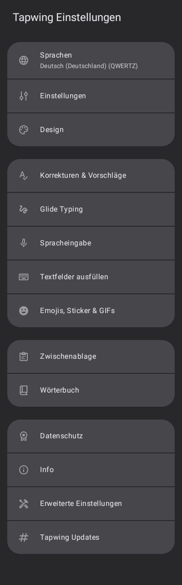
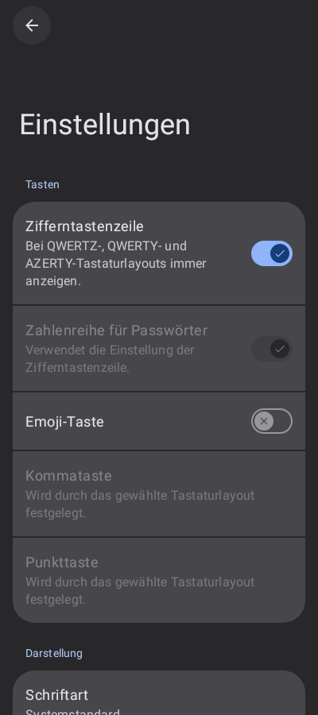
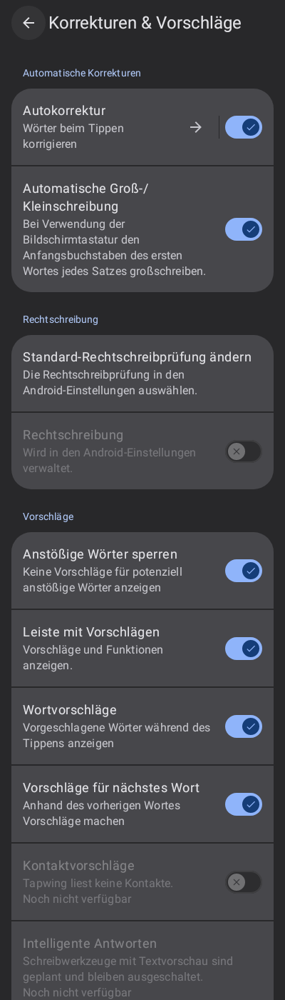
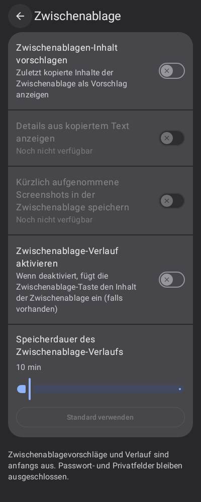
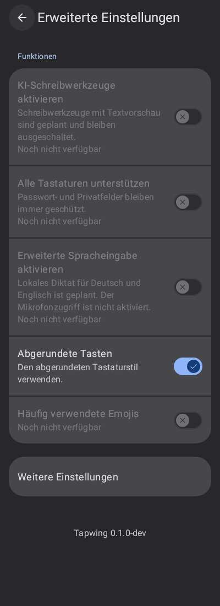

# Einstellungen nach der Nutzervorlage

Die sechs am 6. November 2026 gelieferten PixelBoard-Bilder bestimmen die
Gliederung und den Stil der nativen Tapwing-Einstellungen. Die Umsetzung verwendet
das vorhandene Compose-/SharedPreferences-System und heißt weiterhin Tapwing.

- Vier Hauptgruppen mit Sprachen/Einstellungen/Design, Eingabefunktionen,
  Zwischenablage/Wörterbuch und Datenschutz/Info/Erweitert/Updates.
- Graphit-Hintergrund, zusammenhängende graue Kartengruppen, blaue Schalter,
  runde Zurück-Schaltfläche und große Überschrift für die allgemeinen Einstellungen.
- Schrift-, Emoji- und Verlaufseinstellungen mit direkten Reglern und Rücksetzen.
- Bestehende Optionen bleiben über „Weitere Einstellungen“ erreichbar.
- Kontaktzugriff, KI, Diktat, GIFs und automatische Screenshot-Sammlung werden
  nicht als fertige Funktionen vorgetäuscht. Ihre noch offenen Bereiche sind
  erkennbar deaktiviert. Komma/Punkt bleiben layoutgesteuert. Passwortschutz
  und standardmäßig ausgeschaltete Zwischenablagefunktionen bleiben erhalten.

## Prüfung

12 Compose-UI-Tests prüfen Zustandsänderung, externe Präferenzänderung,
Navigation mit Zurück, echte Tastenstil-Präferenz, Slider-Speicherung/Rücksetzen
und sechs native Renderings. Der Gesamtlauf erfasst 216 Tests:
211 bestanden, 5 bekannte Fälle übersprungen, keine Fehler.

Die Bilder stammen aus dem nativen Robolectric-Renderer mit deutschen Ressourcen,
nicht von einem echten Telefon. Android-Systemleisten wurden nicht nachgezeichnet.
Der Struktur- und Darstellungsabgleich erfolgte anhand der Nutzerbilder.
Honor-/Gerätetests stehen aus. Der zusätzliche unabhängige UI-Review war wegen
Nutzungslimits nicht verfügbar; dieser neue UI-Stand wurde selbst geprüft.
Der frühere Wisch-Fix und die Lint-Baseline wurden unabhängig geprüft.

[Alle allgemeinen Einstellungen](screenshots/settings-preferences-long-robolectric.png)
